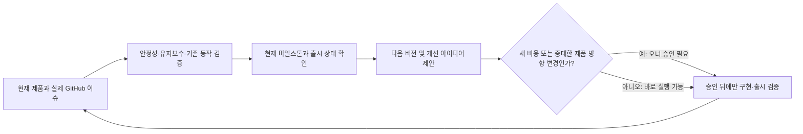

# CodeSampleX 제품 수명주기 계획 (PLC)

## 목적과 현재 기준

CodeSampleX는 공개 라이브러리 사용법이 실제 환경에서 동작하는지 실행 계약으로 확인하고, 환경이 기록된 근거를 제공하는 호환성 테스트 네트워크다. 제품은 출시 단계(`released`)이며 CLI를 제공한다. 2026-11 기준 버전은 `0.2.23`이다. 버전과 출시 상태는 운영 상태 스냅샷(`C:\_Project\LoopOffice2\.data\status-export.json`)에서 확인했다. 사용자에게 보이는 제품 범위와 동작의 기준은 현재 README, 아키텍처·스키마·운영 문서와 코드다.

현재 GitHub 마일스톤은 **2026-11** (`#10`, 목표일 2026-11-30)이며 운영 스냅샷 기준 7개 중 5개 이슈가 완료되고 2개가 열려 있다. 현재 실행 중인 이슈는 **#616, PLC 정본 기록**이다. 스냅샷은 프로젝트 큐에 #616 하나를 표시한다. 대기열이 비더라도 이 계획을 다음 판단의 기준으로 삼는다.

## 수명주기 흐름

## 판단 및 실행 원칙

- 실제 이슈, PR, 마일스톤, 브랜치와 CI를 제품 상태의 원장으로 사용한다. LoopOffice 상태 스냅샷은 제공된 관측 시점의 운영 보조 자료로만 쓴다.
- 버그, 안정성, 유지보수, 기존 동작 검증과 오너 요청을 우선한다. 작은 개선과 이 PLC 갱신은 승인된 범위에서 바로 수행한다.
- 기능 제안은 근거와 수용 기준을 적는다. 새 비용 또는 중대한 제품 방향 변경은 별도 승인을 받기 전 구현하지 않는다.
- 기본 완료 흐름은 이슈 → 브랜치 → 구현 → 로컬 검증 → PR → 리뷰·병합이다. 배포가 요구되거나 릴리스 마일스톤에 포함된 경우에만 배포와 프로덕션 검증을 완료 조건에 더한다.
- 새 유료 자원, 새 인프라, 공개 릴리스 및 운영 배포는 별도 승인·운영 절차를 따른다. 현재 프로젝트 설정의 `deployWorkflow: not_required`를 유지한다.
- 공급자별 가용량, 계정 쿨다운, 링크별 카운터·하트비트·로그와 같이 스냅샷에 없는 운영 텔레메트리는 알 수 없는 값으로 취급한다. 추정해서 채우지 않는다.

## 다음 판단

2026-11 마일스톤에 연결된 실제 열린 이슈와 CI 결과를 확인해 안정성·유지보수 항목부터 처리한다. 마일스톤 완료 후에는 당시의 GitHub 이슈·릴리스·사용 근거를 다시 확인해 다음 버전과 작은 개선 후보를 제안한다. 근거 없는 KPI 목표나 자동 실행용 일감은 만들지 않는다.

## 근거 및 갱신

- 프로젝트 운영 원칙: [`.loop/project.md`](project.md)
- 현재 제품 범위·사용자 기능: [`README.md`](../README.md)
- 구조·운영 계약: [`docs/architecture.md`](../docs/architecture.md), [`docs/schema.md`](../docs/schema.md), [`docs/operations.md`](../docs/operations.md)
- 2026-11 현재 버전, 마일스톤 진행과 큐: 읽기 전용 운영 스냅샷 `C:\_Project\LoopOffice2\.data\status-export.json` (2026-11-07 관측). GitHub 원장이 최종 기준이다.

이 문서는 PLC의 단일 정본이다. 실제 마일스톤, 출시 버전 또는 제품 방향이 바뀌면 해당 GitHub 근거와 함께 갱신한다.
